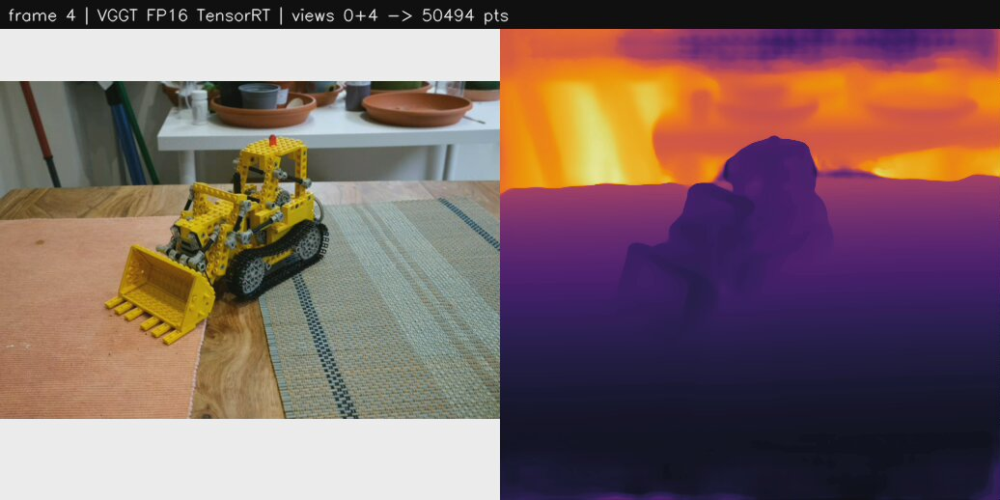
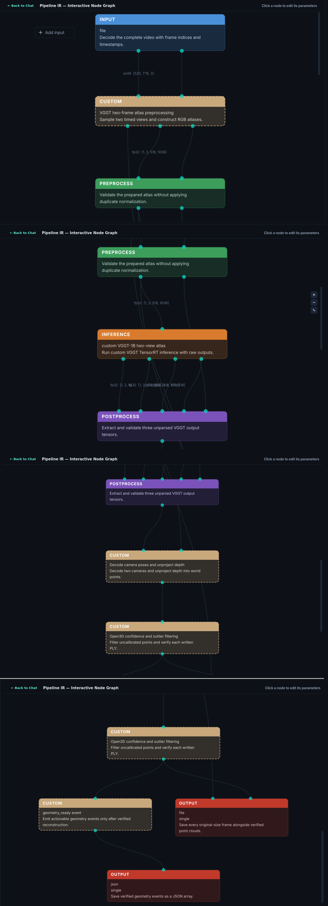

# SPECTRA — two-view 3D reconstruction from video with VGGT

**CraftifAI PipeGen Buildathon · Track A · Participant CRA003**

**In one line:** SPECTRA turns a short video of a static scene into a colored 3D point cloud
and camera positions using VGGT-1B, running as a TensorRT FP16 engine inside a DeepStream
pipeline generated by PipeGen, and sends out a PLY file plus a JSON `geometry_ready` event.



*Real output frame from the DeepStream run: frame 4 of `kitchen-sample.mp4` (left) and the
depth predicted by the PipeGen-built FP16 TensorRT VGGT engine (right); views 0+4 → 50,494 points.*

## Status at a glance

| Item | Status | Evidence |
|---|---|---|
| Official `facebook/VGGT-1B` checkpoint, SHA256 verified, loaded | **Verified** | [`checkpoint_verification.txt`](deliverables/evidence/checkpoint_verification.txt) |
| Real PyTorch inference → ONNX export → ONNX Runtime parity (max depth error 4.1e-5) | **Verified** | [`onnx_parity_report.md`](deliverables/evidence/onnx_parity_report.md) |
| PipeGen Requirement stage (13/13 checks, `bash run.sh` source) | **Done in PipeGen** | [`pipegen/07_*.png`](deliverables/evidence/pipegen) |
| PipeGen Pipeline IR generated and approved | **Done in PipeGen** | [`pipeline_ir.png`](deliverables/evidence/pipeline_ir.png), [`raw/PipelineIR.json`](deliverables/evidence/pipegen/raw/PipelineIR.json) |
| PipeGen Model stage: ONNX inspection 0 unresolved, **FP16 TensorRT engine built** (2,397 MB, 506.7 s) | **Done in PipeGen** | [`12_tensorrt_engine_fp16_built.png`](deliverables/evidence/pipegen/12_tensorrt_engine_fp16_built.png), [`engine_sha256.txt`](deliverables/evidence/pipegen/raw/engine_sha256.txt) |
| PipeGen speed report: **1,464 ms/frame, 57.5 W** (RTX 3050 Laptop) | **Measured by PipeGen** | [`tensorrt_speed_report.png`](deliverables/evidence/tensorrt_speed_report.png) |
| PipeGen accuracy check | **Not available** — PipeGen has no metric for this "custom" task | [`14_accuracy_blocked_custom_task.png`](deliverables/evidence/pipegen/14_accuracy_blocked_custom_task.png) |
| PipeGen Compiler stage: DeepStream pipeline generated, `compile=ok` | **Done in PipeGen** | [`generated_pipeline/`](deliverables/evidence/pipegen/generated_pipeline) |
| PipeGen's own run check | **Failed** — its 5 s smoke test ends before the 2.4 GB engine loads; the generated decode stage was a stub | [`15_*.png`](deliverables/evidence/pipegen/15_pipeline_compile_ok_debugrun_5s.png), [`run1_generated_passthrough/`](deliverables/evidence/pipegen/run1_generated_passthrough) |
| Live DeepStream run, PipeGen pipeline + hand-completed VGGT stages → 4 PLYs + JSON | **Verified** | [`deepstream_run/`](deliverables/evidence/deepstream_run) |
| End-to-end on CPU (ONNX Runtime) → PLY + JSON, web viewer | **Verified** | [`sample_output/`](deliverables/evidence/sample_output), [`viewer_*.jpg`](deliverables/evidence) |

Nothing in this repository is simulated: every number below comes from a file in
`deliverables/evidence/`.

## Pipeline IR node graph (generated by PipeGen)



*PipeGen's approved Pipeline IR (four editor screenshots stitched top to bottom): video input →
two-frame atlas preprocessing → VGGT TensorRT inference → pose/depth decode + filtering →
`geometry_ready` event and outputs. Machine-readable: [`pipegen_project/PipelineIR.json`](pipegen_project/PipelineIR.json).*

## PipeGen project folder

[`pipegen_project/`](pipegen_project) is the PipeGen v0.5.1 session folder
(`~/.pipegen/<user>/0707a4b2-…`) as PipeGen left it: requirement state and history, `PipelineIR.json`,
`model_stage/` (inspection, compile and benchmark data, TensorRT timing cache) and the generated
`pipeline/deepstream/` (config, parsers, `run.sh`). Only the 2.4 GB engine `vggt.fp16.plan` is left
out; PipeGen rebuilds it from `vggt.onnx` in the Model stage (its SHA256 is in
[`engine_sha256.txt`](deliverables/evidence/pipegen/raw/engine_sha256.txt)). To open it in PipeGen,
copy it back under `~/.pipegen/<user>/`. The completed, runnable version of the generated pipeline is
[`deepstream/`](deepstream) (see *Run it on PipeGen's DeepStream pipeline* below).

## Who is it for, and what changes for them?

A disaster-response or robotics team member who needs the layout of a room they cannot
safely walk through. Today they scroll through photos, or need a LiDAR scanner or a slow
multi-photo reconstruction. With SPECTRA, a phone video gives camera poses and a 3D point
cloud (41–73 thousand points per frame pair in our test) with no scanner and no calibration.
Scale is relative, not metres.

## What the pipeline sends out, and who acts on it

For every frame pair SPECTRA writes a verified PLY (re-read and checked before it is
announced) and a camera/metadata JSON, then appends the actionable event to `events.jsonl`.
Real event from the DeepStream run:

```json
{"schema_version": 1, "event": "geometry_ready", "action": "inspect_reconstruction",
 "backend": "tensorrt-deepstream", "frames": [0, 4], "point_count": 50494,
 "scale": "arbitrary; uncalibrated", "ply": ".../pairs/pair_0000_0004.ply",
 "metadata": ".../pairs/pair_0000_0004.json", "stream_seconds": 135.496322,
 "frame_wall_seconds": 27.0214139}
```

`cloud.ply` + `metadata.json` hold the first full pair (frames 0 and 4, the same sampling as the
Python reference). PipeGen's `meta_json` stage also writes per-frame `events.json`. The operator
inspects the cloud in the SPECTRA viewer; robotics software can consume the PLY and JSON directly.

## What the pipeline does, step by step

PipeGen-generated DeepStream pipeline ([`deepstream/run.sh`](deepstream/run.sh)):

1. `nvurisrcbin` decodes the video; `nvstreammux` scales frames to the 1036×518 atlas surface.
2. **VggtPair** (SPECTRA, `nvcustomprocess`): VGGT pad-preprocess the frame from 1 s earlier and
   the current frame to 518×518 each and write them side by side.
3. `nvinfer_backport` runs the **PipeGen-built FP16 TensorRT VGGT engine** (`[1,3,518,1036]` →
   `pose_enc`, `depth`, `depth_conf`, scale 1/255).
4. **VggtDecode** (SPECTRA, `nvcustomprocess`): pose_enc → extrinsics/intrinsics, depth
   unprojection, confidence ≥ 50th percentile, 100k cap, 0.005 voxel grid, statistical outlier
   removal (k=20, 2σ), PLY + metadata + `geometry_ready` event, [view | depth] overlay.
5. PipeGen's `meta_json` stage writes `events.json`; frames are written as JPEG.

Steps 2 and 4 are [`deepstream/parsers/vggt_spectra.cpp`](deepstream/parsers/vggt_spectra.cpp),
a C++ port of the Python reference (`spectra/contract.py`, `spectra/reconstruction.py`, upstream
VGGT `load_fn`/`pose_enc`/`rotation`/`geometry`). PipeGen generated those two stages as a single
`vggt_render` library, but its repair loop gave up after a C++ type error and left it as a
pass-through, and it fed one stretched frame instead of a two-frame atlas. Everything else
(graph, nvinfer config, engine, meta_json) is PipeGen's output, unchanged.

## What we had to fix to get VGGT-1B through PipeGen

| Problem | Fix | Evidence |
|---|---|---|
| ONNX inspection OOM-killed at 15.7 GB RSS | WSL memory 26 GB + 24 GB swap (`.wslconfig`) | [`model_stage_attempt1_oom.txt`](deliverables/evidence/model_stage_attempt1_oom.txt) |
| 57 nodes unresolved by PipeGen's TensorRT probe | [`tensorrt_prep.py`](spectra/deployment/tensorrt_prep.py): constant-fold shape subgraphs, clamp INT64_MAX slice ends, unshare slice parameters, inline INT64 initializers, add shape info. Parity unchanged (depth 4.1e-5) | [`tensorrt_prep_trt3.txt`](deliverables/evidence/logs/tensorrt_prep_trt3.txt) |
| PipeGen compile: "Failed to import initializer" | PipeGen parses bytes with cwd `/opt/PipeGen`, so external weights are not found; symlink `/opt/PipeGen/vggt.onnx.data` | [`tensorrt_parse_check.txt`](deliverables/evidence/tensorrt_parse_check.txt) |
| Compile defaulted to FP32 (does not fit 4 GB) | Asked PipeGen for FP16 | [`12_*.png`](deliverables/evidence/pipegen/12_tensorrt_engine_fp16_built.png) |
| Generated decode stage was a stub, single-frame input | `deepstream/parsers/vggt_spectra.cpp` (above) | [`deepstream_run/`](deliverables/evidence/deepstream_run) |

## Does the engine agree with the reference?

PipeGen could not score this model, so we compared the DeepStream run's cameras for frames 0+4
with the CPU ONNX Runtime reference run on the same frames
([`sample_output/metadata.json`](deliverables/evidence/sample_output) vs
[`deepstream_run/metadata.json`](deliverables/evidence/deepstream_run/metadata.json)):

| | ONNX Runtime CPU (FP32) | DeepStream TensorRT FP16 |
|---|---|---|
| Camera baseline (view 0 → view 1) | 1.5762 | 1.5689 (−0.5%) |
| View 1 rotation difference | — | 1.27° |
| Focal length fx (view 0 / view 1) | 596.5 / 509.0 | 550.6 / 515.2 |
| Points after filtering | 51,678 | 50,494 |

The geometry agrees closely. The remaining differences come from different inputs as well as
FP16: DeepStream resamples the frame twice (stream muxer, then OpenCV `INTER_AREA` instead of PIL
bicubic) and passes it through NV12 4:2:0 colour. A same-input FP16-vs-ONNX tensor comparison is
not done yet.

## How fast, on what hardware

NVIDIA GeForce RTX 3050 Laptop GPU (4 GB), Intel Core i5-12450H, Windows 11 + WSL2, PipeGen v0.5.1
container (DeepStream 7.1, TensorRT 10.3.0).

| Measurement | Value | Source |
|---|---|---|
| PipeGen benchmark, FP16 engine, GPU compute | **1,464 ms / frame**, 57.5 W | [`tensorrt_speed_report.png`](deliverables/evidence/tensorrt_speed_report.png), [`engine.data.json`](deliverables/evidence/pipegen/raw/benchmark/engine.data.json) |
| Same model, ONNX Runtime CPU forward pass | 37.7 s | `sample_output/metadata.json` |
| DeepStream pipeline, wall time per frame | **~27 s** | [`spectra_deepstream_run.log`](deliverables/evidence/deepstream_run/spectra_deepstream_run.log) |
| Engine load in DeepStream | ~9 s | same log |

The engine is ~26× faster than CPU in PipeGen's benchmark, but the full DeepStream pipeline is
much slower than the benchmark. PipeGen's own unmodified pipeline was equally slow (2 min 38 s for
8 frames), so this is not the SPECTRA C++ stages. The cause is not isolated yet; the likely
suspect is the 4 GB GPU: DeepStream's decoder and buffers plus the 2.4 GB engine leave
too little VRAM, so WSL2 spills to shared system memory. PipeGen's benchmark card also labels the
input `1×3×518×518`, while the engine and `engine.data.json` use `1×3×518×1036`.

## What it does not handle yet

- DeepStream throughput (~27 s/frame) is far below the engine benchmark (1.46 s); not yet diagnosed.
- PipeGen's accuracy step cannot score a custom pose/depth model; agreement was checked by hand above.
- Two views per reconstruction; the four pair clouds are not merged into one map.
- Scale is relative (not metres).
- Tested on one indoor scene (8 frames built from upstream VGGT's kitchen images, not new footage).

## Run it on PipeGen's DeepStream pipeline

Requires PipeGen v0.5.1 (container `craftifai-amd64-v3`), the TensorRT-ready bundle from
`python -m spectra.deployment.tensorrt_prep artifacts/vggt-onnx-run2 artifacts/vggt-onnx-trt3`,
and the engine PipeGen builds from it (path in `deepstream/configs/config_vggt.txt`):

```bash
docker exec craftifai-amd64-v3 bash /home/atharv/spectra/repo/deepstream/run.sh
# -> output/cloud.ply, metadata.json, events.jsonl, events.json, pairs/, frames/
```

## Run it on CPU (reference)

```powershell
git clone --recurse-submodules https://github.com/atharv-namdeo/CraftifAIHackathon_CRA002.git
cd CraftifAIHackathon_CRA002
py -3.12 -m venv .venv; .venv\Scripts\Activate.ps1
python -m pip install torch==2.7.1 torchvision==0.22.1 --index-url https://download.pytorch.org/whl/cpu
python -m pip install "numpy<2" Pillow einops safetensors huggingface_hub -r requirements-spectra.txt -r requirements-export.txt
python -m pip install --no-deps -e ./vggt
python scripts/fetch_checkpoint.py                      # downloads + SHA256-verifies VGGT-1B (~5 GB)
powershell -File scripts/run_export_windows.ps1 -Output artifacts/vggt-onnx-run2   # real export + parity
python scripts/make_sample_video.py
python -m spectra.deployment.reference artifacts/kitchen-sample.mp4 --backend onnx --device cpu `
  --bundle artifacts/vggt-onnx-run2 --output artifacts/e2e-run
# Viewer:
$env:SPECTRA_BACKEND='onnx'; $env:SPECTRA_DEVICE='cpu'; $env:SPECTRA_MAX_FRAMES='2'
$env:SPECTRA_DEPLOYMENT_DIR="$PWD\artifacts\vggt-onnx-run2"; python -m spectra.app   # http://127.0.0.1:5000
```

Large files are not in Git: checkpoint (`artifacts/checkpoints/VGGT-1B`, 5.03 GB) and ONNX bundle
(`artifacts/vggt-onnx-run2`, 4.6 GB); both are reproduced by the commands above.

---

# Technical details

VGGT is the only model. The official upstream repository is preserved in `vggt/`,
commit `a288dd0f14786c93483e45524328726ab7b1b4ce`, with no source/pin changes.

## Start here

Clone this repository with its pinned upstream VGGT dependency:

```bash
git clone --recurse-submodules https://github.com/arshpreet-svg/spectra-vggt.git
cd spectra-vggt
```

For an existing clone, run `git submodule update --init --recursive`.

For the complete **export → PipeGen → engine comparison → DeepStream → viewer**
commands, read [VGGT/PipeGen handoff](docs/VGGT_PIPEGEN.md).
Supply [the requirement](pipegen/requirement.md) to PipeGen. The architecture JSON is
an authored reference graph; preserve PipeGen's actual generated PIR separately.

## Install the application/export environment

Python 3.12 recommended. From this directory in an existing Linux/WSL environment:

```bash
python3.12 -m venv .venv
source .venv/bin/activate
python -m pip install torch==2.7.1 torchvision==0.22.1 --index-url https://download.pytorch.org/whl/cu128
python -m pip install 'numpy<2' Pillow huggingface_hub einops safetensors
python -m pip install -r requirements-spectra.txt -r requirements-export.txt
python -m pip install --no-deps -e ./vggt
python scripts/preflight.py
```

For the local Mac, install the same torch/torchvision pair from the normal PyPI index,
without the CUDA index argument. Native Windows uses `py -3.12 -m venv .venv` and
`.venv\Scripts\Activate.ps1`. PipeGen itself requires its documented Linux setup.

The separately installed runtime uses newer PyTorch than upstream's torch==2.3.1 pin
because RTX 50-series Blackwell support needs a newer CUDA build. The upstream dependency
file is unchanged. The target pair must pass a real CUDA operation on your actual laptop.
See https://pytorch.org/blog/pytorch-2-7/ and `scripts/preflight-windows.ps1`.

Use PipeGen's selected DeepStream environment and matching TensorRT/`pyds` bindings;
these are not ordinary portable pip dependencies and have not been installed on this Mac.
Approve administrator, Docker and group changes yourself before running vendor setup.

## Smallest original-model inference

```bash
export HF_HOME="$PWD/artifacts/hf-cache"
python scripts/upstream_smoke.py
```

This uses one bundled real kitchen image, actual pretrained weights and upstream
preprocessing. Success evidence is written only after the forward pass. The roughly
5 GB checkpoint download failed in this session with curl error 92 (HTTP/2 CANCEL).
The 681 MiB `artifacts/model.safetensors` is incomplete and must not be loaded.
The complete official safetensors SHA256 is
`f164acf60724910d8fe1578bb499d800850c7bb0948db7555c413f9fbe60467e`.
A complete verified local checkpoint directory can be selected with `SPECTRA_MODEL_ID`.

## Export for PipeGen

```bash
python -m spectra.deployment.export \
  vggt/examples/kitchen/images/00.png vggt/examples/kitchen/images/01.png \
  --output artifacts/vggt-onnx --device cpu
```

The wrapper packs two padded 518x518 views into a conventional `[1,3,518,1036]` RGB
input, then unpacks them within ONNX before joint VGGT inference. Outputs are original
pose encoding, depth and confidence. Do not normalize twice: VGGT handles ImageNet
normalization internally. External graph weight files must travel with the ONNX file.

The exporter checks fixed-grid specialization equivalence and ONNX Runtime agreement
against actual PyTorch predictions. A valid manifest is written only after these pass.
No random-weight fallback exists. Local synthetic test bundles are labeled and rejected
by production runtimes. A full-model export can require considerable host RAM.

Import the validated bundle/repository through PipeGen's custom model workflow, compile
there, retain its actual engine/speed report, and follow [the target guide](docs/VGGT_PIPEGEN.md).
No unsupported PipeGen CLI or generated IR format is invented here.

## Local reconstruction and viewer

PyTorch baseline:

```bash
python scripts/make_sample_video.py
python -m spectra artifacts/kitchen-sample.mp4 --device cuda --max-frames 2
python -m spectra.app
```

For a real engine compiled by PipeGen:

```bash
export SPECTRA_BACKEND=tensorrt
export SPECTRA_DEPLOYMENT_DIR="$PWD/artifacts/vggt-onnx"
export SPECTRA_ENGINE_PATH=/home/USER/pipegen-export/vggt.engine
python -m spectra.app
```

Open **http://127.0.0.1:5000** and upload two overlapping images or a short video.
The ONNX/TensorRT adapters require exactly two sampled views. The PyTorch baseline
also supports one view. The supplied sample video uses real-scene upstream images;
it is not newly filmed footage. Viewer assets are pinned/vendored Three.js 0.170.0.

Configuration in `spectra/config.py`: `SPECTRA_BACKEND=pytorch|onnx|tensorrt`,
`SPECTRA_DEPLOYMENT_DIR`, `SPECTRA_ENGINE_PATH`, `SPECTRA_DEVICE=auto|cpu|cuda`,
`SPECTRA_MAX_FRAMES`, `SPECTRA_OUTPUT_DIR`, `SPECTRA_MODEL_ID`. Start with two frames
and measure available memory. Runtime selection is explicit; there is no silent fallback.

The loopback server permits one reconstruction at a time. Artifacts: `cloud.ply`,
`metadata.json`, `predictions.npz`. PLY is read back through Open3D to check validity.
JSON records runtime and engine hashes when present; it does not assert PipeGen provenance.

**Scale is arbitrary.** Translations and voxel sizes are not metres. Independent windows
are not registered. This is bounded reconstruction, not continuous loop-closed SLAM.
Review upstream checkpoint/code licensing before sharing or using commercially.

## Verification

```bash
python -m pytest -q
python -m compileall -q spectra scripts
```

Tests cover atlas order, upstream RoPE equivalence, ONNX/ORT adapter roundtrip with an
explicit synthetic attention model, known-camera geometry decoding, frame sampling,
PLY readback, Flask upload/export and failure paths. They are not model benchmarks.
See `evidence/status.json` for implementation/test/target-verification distinctions.

Earlier detection-adapter source remains inactive. No detector or FirmGen project is
part of the active pipeline. The source handoff omits checkpoints, virtualenv and Git
history; the local `vggt/` checkout retains its upstream history.
